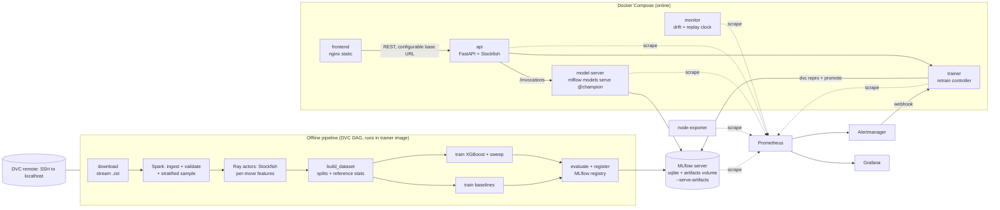

# Guess the Elo — Design Document (v0.6, approved 2026-11-15; deadline re-plan, lean scope D26, SSH remote D27, engine nodes D28)

> **Status:** this is the current approved design (`CLAUDE.md`). It was approved by the user on 2026-11-15. The history of how it got here is in `docs/journal/` (`JOURNAL.md`, `DECISIONS.md`). Any change to it must be proposed, approved by the user, and recorded there first. `DESIGN.md` and the journal feed the mandatory `docs/architecture.md`, `hld.md`, `lld.md`, `test_plan.md` and `user_manual.md`, and an `AI_DISCLOSURE.md` is added.
>
> **Roles** (from `CLAUDE.md`):
> - **Claude** is the architect, planner, supervisor and reviewer. It writes only documentation: `DESIGN.md`, the journal and the docs.
> - **Codex** is the only implementation agent, reached through the `agent-link` MCP. It writes all code and configs, runs the tests, and reports back.
> - **Claude reviews** every milestone by reading the actual diffs before the next milestone starts (§18).
>
> **Fair-use note** (from `AI-fair-use-code-of-conduct.pdf`): the course forbids *"Using an AI to design your entire end-to-end MLOps architecture without engaging in the design trade-off process."* Every decision below is therefore written as a numbered decision with the alternatives considered and the course link, so you can challenge, change and defend it. U1–U4 were chosen explicitly by the user. D1–D20 were proposed by Claude and accepted by the user on 2026-11-15 when this design was approved. The full ADRs are in `docs/journal/DECISIONS.md`.

---

## 0. Context

- **Goal:** estimate both players' ratings from one PGN, with an uncertainty range and the most influential moves.
- **Requirements:**
  - Served to non-technical users through a web UI.
  - Built and run with the course stack: Spark, Ray, DVC, MLflow, FastAPI, Docker Compose, Prometheus and Grafana.
  - Detects drift and retrains automatically.
- **Grading:** `project/proposal/evaluation_guidelines.pdf` (25 points) and `development_guidelines.pdf`. Cloud platforms are **not allowed**, so everything runs on one laptop.
- **Constraints of that laptop:**
  - 12 cores, 22 GB RAM (about 14 GB already in use), 32 GB free disk.
  - RTX 4050 with 6 GB.
  - Java 17, Docker 29 and Compose 2.40 are installed.
  - The conda env `da3408-project` (Python 3.12.15) is empty.

**Decisions already taken (from you):**

| # | Decision | Choice |
|---|---|---|
| U1 | Frontend | Static HTML/JS (chess.js + chessboard.js) served by **nginx** |
| U2 | Model ambition | ~~GBM champion + GRU challenger~~ **Superseded (user, 2026-11-15, deadline): XGBoost champion; MLflow comparison is the baselines B0–B2 plus an XGBoost sweep** |
| U3 | Data window | **2020 pandemic replay**: train on late 2019, replay 2020 as "production" |
| U4 | Kubernetes / KServe / Ray Serve | **Out of scope, justified** (§12) |

---

## 1. Problem definition and success metrics (Guidelines §II.A)

- **Input:** one PGN, which may contain several games; the user picks one.
  - Lichess exports include clocks (`%clk`), and sometimes evals (`%eval`).
  - Over-the-board (OTB) PGNs usually have no clocks.
- **Output per side:** a point estimate of the **Lichess-equivalent rating** for that time-control class, an 80% interval, and the top-k influential moves.
  - The UI says "Lichess-equivalent" explicitly, because FIDE and Lichess scales differ.
- **ML metrics:**
  - MAE (primary) and RMSE.
  - MAE broken down by time-control class and by rating band.
  - 80% interval **coverage** and mean interval width.
- **Baselines:**
  - B0: global mean rating.
  - B1: mean rating per time-control class.
  - B2: linear regression on (time-control class, result, number of plies).
- **Acceptance criteria** (Testing rubric):
  - **AC1** test MAE ≤ 0.75 × B1 MAE.
  - **AC2** 80% interval coverage within [0.75, 0.85].
  - **AC3** `/v1/predict` p95 latency ≤ 5 s for a 40-move game on the laptop.
  - **AC4** invalid input always returns 4xx, never 5xx.
  - **AC5** in the 2020 replay, a drift alert triggers a retrain, and the promoted model's MAE on the next month is lower than the old champion's.
  - **AC6** all unit tests pass.
- **Business framing:** OTB and unrated players get a strength estimate from a single game, plus a "why" (the influential moves).

---

## 2. Data

- **Source:** Lichess Open Database (CC0), monthly `lichess_db_standard_rated_YYYY-MM.pgn.zst`.
- **Months:**
  - Training reference: **2019-09 → 2019-12**.
  - Replay stream: **2020-01 → 2020-12**. Lockdown starts in March and the *Queen's Gambit* surge comes in Oct–Nov, so there is real influx of new players and real rating drift.
  - Both lists are in `params.yaml`.
- **Acquisition:** full monthly dumps are tens of GB compressed each, so the downloader **streams** the `.zst` and stops after `max_games_per_month`.
  - Default is 60k games before filtering. 10k is used while developing.
  - Known bias: this keeps only the first days of each month. It is documented in the data card.
- **Filters** (Spark):
  - Rated, standard variant, with clock annotations.
  - Blitz, rapid and classical only. Bullet is excluded because premove noise dominates.
  - ≥ 10 plies per side.
  - Both Elo values present and within 600–3200.
  - Not aborted.
- **Leakage controls:**
  - All rating-bearing headers are stripped before features are built: `WhiteElo`, `BlackElo`, `*RatingDiff`, `Title*`.
  - Player names are hashed and never used as features.
  - Splits are by **time**, not at random.
- **Known label noise:** provisional ratings are not flagged in the PGN, because the rating deviation is absent. This is documented, and it shows up as error in low-game-count bands.
- **Splits:**
  - Train is 2019-09..11.
  - Validation and conformal calibration both come from 2019-12 (two disjoint halves).
  - Test is a 2019-12 holdout; replay months are evaluated as they "arrive".

**Stockfish compute budget:**
- Settings are fixed-node search (default `nodes=20000`), Multi-PV 1, with existing `%eval` reused when present. Assuming roughly 1–1.5 M nodes/s per core and about 70 plies per game, that is about 1–1.4 s per game per core. Measured in M3.
- Ray uses 10 workers, so roughly 7–10 games/s.
- The proposed sample is **asymmetric**: 20k games per training month and 10k per replay month, about 200k games in total. That is **roughly 6–7 h** at 20k nodes, or about 3.5 h at 10k nodes. The earlier figure of 16 months × 20k was about 10–12 h.
- This runs once and is cached by DVC.
- The sample size is a parameter, so a dev run takes minutes.

---

## 3. Architecture (HLD)



**The blocks** (they become the architecture-diagram explanation):

1. **frontend** (nginx, :8080): upload/paste PGN, game picker, board replay with influential moves highlighted, rating cards with intervals, Pipeline console page, Help/manual page.
   - Talks only to `api`, through `API_BASE_URL` set in `config.js` and injected at container start. This satisfies the rubric's "loose coupling via configurable REST".
2. **api** (FastAPI, :8000; metrics on :18000):
   - Runs PGN parsing and sanitising, and Stockfish analysis using the *same* `elo.features` code as the pipeline. Shared code avoids training/serving skew (Lecture 1, Sculley's "pipeline jungles").
   - Calls the model server, emits metrics, and proxies pipeline-console calls to `trainer`.
3. **model-server** (`mlflow models serve -m models:/elo-estimator@champion`, :5001).
   - The model is a **custom pyfunc** that takes per-move feature rows and does its own model-specific preprocessing: aggregation for XGBoost. The interface stays model-agnostic, so a sequence model could be added later.
   - It also runs conformal intervals and occlusion-based move influence, so the logic travels with the model version.
   - Its entrypoint polls the alias every 60 s and restarts `mlflow models serve` when the alias moves. Lecture 10 notes that an alias move needs a restart.
4. **mlflow** (tracking server and registry, :5000): sqlite backend on a volume; artifacts on a named volume, served by the tracking server (`--serve-artifacts`), so clients need no storage credentials (D27). Started with `--expose-prometheus`.
5. **DVC remote** (D27): an SSH remote on the host (`ssh://localhost/~/dvc-storage/guess-the-elo`), with a dedicated key. Not a container.
6. **trainer** (FastAPI controller, :8001; metrics on :18002):
   - Receives Alertmanager webhooks and manual retrain requests.
   - Runs `dvc repro` (Spark local mode and Ray local cluster inside the image).
   - Applies the promotion gate, keeps the run history in SQLite, and serves the pipeline console data.
7. **monitor** (:18001):
   - Holds a **replay clock** that reveals one 2020 month every N minutes (demo-configurable).
   - Scores that month's precomputed features with `@champion` and computes MAE, coverage and per-feature PSI against the training reference stats. It exports these as gauges.
   - Online labels from uploads were removed by D26; drift performance uses the labelled replay months only.
8. **prometheus / alertmanager / grafana / node-exporter**: the standard Lecture 9 stack. Dashboards and alert rules are provisioned as code.

**Retraining loop:**
1. A replay month arrives and `elo_batch_mae` or `elo_feature_psi` crosses its threshold.
2. A Prometheus alert fires (with `for:` debounce) and Alertmanager calls the `trainer` webhook.
3. The trainer appends the revealed months to `params.yaml:train.months`, then runs `dvc repro`, which creates new MLflow runs.
4. The challenger is registered with the `@challenger` alias.
5. **Gate:** the challenger's MAE on the newest revealed month must be lower than the champion's by at least δ, and its coverage must be within band.
6. If it passes, `@champion` moves and the previous version gets `@previous_champion`.
7. The model-server reloads. The trainer runs `dvc push` (data and models to the SSH remote) and records the base git commit, the `dvc.lock` hash and a `git_dirty` flag as tags on the MLflow run.
   - By default it does **not** create git commits. The run is listed as "pending commit" in the Pipeline console, and you commit `params.yaml` and `dvc.lock` yourself.
   - This is in line with `CLAUDE.md`'s "no commit without explicit permission". Auto-commit was decided **off** by the user on 2026-11-15.
8. A cooldown stops repeated triggers.
9. **Rollback** is `make rollback` (D26), which moves `@champion` back to `@previous_champion`. This is the Guidelines' "rollback mechanism".

---

## 4. Decision log (each one is justified and tied to the course)

| # | Decision | Alternatives | Why | Course link |
|---|---|---|---|---|
| D1 | **Spark** for ingest, validation and sampling | pandas; Ray Data for everything | Parsing multi-GB text is columnar, data-parallel ETL with filters, group-bys and dedup, which is what Spark DataFrames are for. A custom record delimiter (`\n\n[Event `) splits games. Output is Parquet partitioned by month. | L7 Spark ETL (`partitionBy().parquet`, `explain`, avoid `collect`) |
| D2 | **Ray actors** for Stockfish analysis | Spark UDF; multiprocessing | Each actor owns one long-lived Stockfish process ("create the actor once"), which is stateful and CPU-bound. A Python UDF in Spark would restart engines and pay JVM↔Python overhead (the Mod2 benchmark lesson). The rule of thumb is "Spark distributes tables, Ray distributes code". Ray Data `map_batches` with an actor pool. | L8 Ray (tasks, actors, Ray Data); Mod2 Spark vs Ray assignment |
| D3 | Spark in `local[*]` and Ray as a local cluster, no standalone cluster | Spark standalone with 2 workers | One laptop with limited RAM. Throughput is reported, and the Spark UI (:4040) and Ray dashboard (:8265) are kept as evidence. | L7, L8 |
| D4 | **XGBoost** champion | LightGBM; Spark ML RF | Tabular aggregates suit gradient-boosted trees. XGBoost is the GBM taught (Ray AIR `XGBoostTrainer`). It has `mlflow.xgboost.autolog`, handles NaN for games without clocks, and is fast. | L8 Ray AIR; L3 autolog |
| D5 | ~~**GRU** challenger~~ **SUPERSEDED 2026-11-15 (deadline; see U2)** over per-move sequences (PyTorch, GPU for training) | Transformer | It could capture temporal patterns such as time trouble, and gives a genuine model comparison in MLflow. A GRU is small enough for 6 GB. | L3 (log per epoch with `step=`; Mod1 deducts for final-only metrics) |
| D6 | **Two "perspective" rows per game:** own features + opponent's features + colour → that player's rating, with one model for both sides | Two separate models | Doubles the data, symmetric by construction, one artifact. | — (ML design) |
| D7 | Uncertainty via **split conformal**, Mondrian by time-control class | Quantile regression; NGBoost | Model-agnostic, so it works for any regressor. It has a coverage guarantee and coverage is directly testable (AC2). | — (ML design) |
| D8 | Move influence via **occlusion** (mask a move, re-aggregate, record Δprediction), batched as N+1 rows | SHAP (feature-level, not move-level); attention | The brief asks for *moves*, not features. Occlusion is model-agnostic and lives inside the pyfunc. SHAP feature importance is still logged in MLflow for the explainability guideline. | Guidelines §IV Explainability |
| D9 | **MLflow model server** behind **FastAPI**, not FastAPI loading the model directly | FastAPI only; Ray Serve | The rubric asks for both "MLflow for APIfication" and "FastAPI for UI APIs". The split also lets the model reload independently of the API. Ray Serve is dropped (U4). | L10 MLflow serving and REST serving; rubric Packaging |
| D10 | Custom **pyfunc** with signature and input example | Plain flavor | Preprocessing, conformal and occlusion are versioned with the model. The lecture calls a missing signature "#1 cause of 'works in Python, fails when served'". | L3, L10 |
| D11 | Registry **aliases** (`champion`, `challenger`, `previous_champion`) | Stages | Stages are deprecated, and the lecture says to "target an alias, never a version". | L3, L10 |
| D12 | **DVC pipeline** (`dvc.yaml` + `params.yaml` + `dvc.lock`) as the CI backbone | Airflow; Make | "CI/CD: DVC" is mandated by the Guidelines. The rubric asks for a DVC DAG, `dvc repro` gives incremental re-runs, and `dvc metrics diff` / `params diff` gate changes. | L11, L2 |
| D13 | DVC stages invoke **`mlflow run . -e <entry>`** (MLproject + `python_env.yaml`) | Calling python directly | Every training run then automatically records `mlflow.source.git.commit`. That meets "reproducible via Git commit + MLflow run ID" and the rubric's MLprojects for dev/test parity (`--env-manager=local` in dev, `virtualenv` in the test container). Uses `--experiment-name`, not `set_experiment` (the Exercise 2 gotcha). | L3 MLproject; Guidelines §I |
| D14 | **Git LFS** for small binary assets: test-fixture PGN bundles, demo games, doc screenshots. **DVC** for data and models. | All LFS; all DVC | LFS suits small and medium binaries that must be present on clone (tests need them). DVC suits large pipeline artifacts with lineage. Using both shows the trade-off the rubric asks about. | L2 (LFS vs DVC) |
| D15 | ~~**MinIO** as a self-hosted S3 remote~~ **SUPERSEDED by D27 (2026-11-15): MinIO images no longer published** | Local folder remote | Mod1 did not accept local remotes, and cloud is banned. It also backs MLflow artifacts. *Beyond the course* (an S3 remote is taught; MinIO is just the self-hosted server). | L2 remotes; Mod1 |
| D16 | Metrics on a **separate port** via `start_http_server`, one exporter per process | `/metrics` route | Matches `Monitoring/ai_app.py` (:18000) and the Mod6 requirement. Uvicorn runs with `workers=1` and a threadpool (`def`, not `async def`, for CPU-bound work) to avoid multiprocess metric issues. | L9; L10 REST serving |
| D17 | Drift via **PSI and KS computed by hand**, plus MAE on labelled replay months | Evidently | Drift libraries are not taught, and about 30 lines of code are easy to defend in the viva. The syllabus names a "drift-detection dashboard" lab. | L9; syllabus wk10 |
| D18 | **Docker Compose**, multi-stage `-slim` images, `.dockerignore`, healthchecks, `depends_on: condition: service_healthy` | K8s | Single host, and Compose is the graded packaging. Healthchecks are *beyond the course* but are needed so `/ready` returns 200 only after the model loads (a Mod3 deduction). | L4/L5; Mod3 |
| D19 | Code paradigm: **OO for services and stateful components** (`PgnParser`, `EngineAnalyzer`, `FeatureBuilder`, `EloPyfunc`, `DriftMonitor`, `RetrainController`), **functional for pipeline transforms** | Pure OO | The rubric asks "OO or functional". Each style is used where it fits, and the doc says why. | Rubric Design |
| D20 | Security: upload cap (1 MB), python-chess parsing only, CORS limited to the frontend origin, an API key on trainer/admin endpoints, secrets in `.env` (not committed), TLS on nginx with a **mkcert** locally trusted certificate (`make certs`; cert files gitignored; mkcert is beyond the course) | None | The Guidelines ask for "encryption" and the rubric for a foolproof UX. | Guidelines §IV |

---

## 5. Features (shared `elo.features` package)

**Per-move rows,** the output of the Ray stage and the input to the pyfunc:
- **Identity and context:** ply, side, SAN, phase (opening, middlegame, endgame by material).
- **Engine:** centipawn loss (clipped), win-probability loss, best-move match, and a blunder/mistake/inaccuracy class.
- **Position:** legal-move count (complexity), whether in check, material balance and its change.
- **Time:** seconds spent, clock fraction remaining, time-trouble flag, increment.
- **Opening:** whether the move is still in book, from an ECO prefix match.

**Game aggregates** (XGBoost input, built inside the pyfunc):
- Per side: mean, median and p90 CPL; win-probability loss; accuracy; blunder rate by phase; book depth; time-use statistics; correlation of move time with complexity; material swings.
- Shared: result, termination, time-control class, base and increment, plies.
- Missing clocks (OTB games) give NaN plus a `has_clock` flag.
  - Training randomly drops clocks for 20% of games (clock dropout) so the model still works on OTB PGNs.

**Reference stats:** binned feature distributions from the training data are saved as the `reference_stats.json` artifact **inside the model**, so drift is always measured against the champion's own training data.

---

## 6. Experiment tracking (rubric: "besides autolog")

- **Autolog:** `mlflow.xgboost.autolog()` for XGBoost, whose per-iteration eval metrics are logged with `step=`.
- **Params logged manually:**
  - All of `params.yaml` (months, sample sizes, engine nodes, features on or off), seeds.
  - The DVC data hash from `dvc.lock`; the git commit is recorded automatically via MLproject.
- **Metrics:** overall MAE and RMSE; MAE per time-control class and per rating band; coverage; interval width; improvement over B0, B1 and B2; pipeline throughput (games/s) for each stage.
- **Artifacts:**
  - Plots: residuals vs true rating, calibration/coverage, SHAP summary, learning curves.
  - Data: feature list, `reference_stats.json`, confusion of rating bands, data-validation report.
- **Tags:** `trigger=manual|drift_alert`, `alert_name`, `train_months`, `parent_champion_version`.
- **Sweeps:** small grids run as **nested runs**, executed in parallel with Ray tasks. Ray Tune is not used because it was not taught. The best run is picked with `mlflow.search_runs` on the **validation** metric.

---

## 7. DVC pipeline (rubric: "DVC DAG representing your CI pipeline")

```
download (foreach month) → ingest_validate (Spark) → sample (Spark) → analyze (Ray+Stockfish)
→ build_dataset → {train_baselines, train_xgb, train_gru} → evaluate → register
tests (pytest → reports/tests.json)   [also a stage, so `dvc repro` = build + test]
```

- Each stage declares its `deps`, `params` and `outs`.
- `metrics:` include `reports/validation.json`, `reports/throughput.json` and `reports/metrics.json`.
- `plots:` cover residuals and coverage.
- **Local CI** (`make ci`): `ruff` + `black --check` → `pytest` → `dvc repro` → `dvc metrics diff main` → fail if the AC thresholds are violated.
- **Optional:** a GitHub Actions job that runs lint and unit tests only (no data). It is *beyond the course* and marked as such.
- The Pipeline console in the UI renders `dvc dag --mermaid`.

---

## 8. Monitoring (Prometheus metric catalogue; all names prefixed `elo_`)

| Component | Metrics |
|---|---|
| api | `requests_total{endpoint,status}` Counter; `request_latency_seconds{endpoint}` Histogram; `inflight_requests` Gauge; `pgn_bytes` Summary; `engine_analysis_seconds` Histogram; `parse_errors_total{reason}`; `predicted_rating{side,tc}` Histogram; `interval_width` Histogram; `online_abs_error` Histogram (when labels exist); `model_server_errors_total`; `build_info` Info |
| model-server / mlflow | MLflow `--expose-prometheus`; `up` |
| monitor | `feature_psi{feature}`; `batch_mae{month,tc}`; `interval_coverage{month}`; `replay_month`; `drift_detected` |
| trainer | `pipeline_runs_total{status}`; `stage_duration_seconds{stage}`; `stage_throughput_games_per_second{stage}`; `retrain_in_progress`; `champion_version`; `last_retrain_timestamp` |
| host | node-exporter (CPU, memory, disk) |

**Alert rules** (each with `severity`, `summary` and `description`, which improves on the course sample):
- `ModelMAEDegraded`: `batch_mae > 1.15 × reference MAE`, `for: 2m`, critical, routed to the trainer.
- `FeatureDriftHigh`: `max(psi) > 0.25`, warning.
- `CoverageOutOfBand`
- `ApiErrorRateHigh`
- `ApiLatencyP95High`
- `ServiceDown`: `up == 0`.
- An inhibition rule (as in the course sample): a critical alert suppresses the matching warning.
- AI-written PromQL is commented with its prompt, as the Mod6 conduct rule requires.

**Grafana** (provisioned JSON, following the Mod6 "7 commandments": colour-blind-safe palette, units, titles, legends, descriptions):
1. **Service health:** up/down, RPS, latency p50/p95/p99, error ratio, in-flight requests, node CPU and memory.
2. **Model quality and drift:** MAE by month, coverage, PSI heatmap, distribution of predicted ratings, and annotations whenever the champion changes.
3. **Pipeline:** stage durations, throughput, success/failure counts.

---

## 9. LLD: API endpoints (completed in `lld.md` with full JSON schemas)

**api** (`/v1`). All errors use the shape `{"error":{"code","message","request_id"}}`.

| Method | Path | Input | Output | Errors |
|---|---|---|---|---|
| GET | `/health` | – | `{status}` | – |
| GET | `/ready` | – | 200 only when the model server and the engine are reachable | 503 |
| POST | `/v1/games/parse` | multipart `file` or `{pgn}` | `{games:[{index, white, black, date, tc, plies, has_clock}]}` | 400 bad PGN, 413 too large, 422 |
| POST | `/v1/predict` | `{pgn, game_index=0, top_k=5}` | `{white:{elo,lo,hi}, black:{…}, tc_class, influential_moves:[{ply,san,side,delta_elo}], analysis:{source, nodes, seconds}, model:{name,version,run_id}, request_id}` | 400, 413, 422, 503 model down, 504 analysis timeout |
| GET | `/v1/model` | – | champion metadata | 503 |
| GET | `/v1/pipeline/dag` | – | mermaid text | – |
| GET | `/v1/pipeline/runs` | `?limit` | `[{run_id, trigger, status, stages:[{name,status,duration_s,games_per_s,error?}], mlflow_run_id}]` | – |
| POST | `/v1/pipeline/retrain` 🔑 | `{reason}` | `{run_id}` 202 | 409 if a run is in progress |

**Other services:**
- **trainer:** `POST /alerts` (Alertmanager webhook format), `POST /retrain`, `GET /runs`, `GET /runs/{id}`, `GET /status`.
- **model-server:** the MLflow-standard `/invocations` (`dataframe_split` of per-move rows), `/ping`, `/version`.
- **monitor:** `/metrics`, `GET /status`, and `POST /clock/advance` 🔑 for the demo.

**Client behaviour:** the api calls the model-server with a timeout, retrying only 5xx and network errors with exponential back-off (the course `safe_predict` pattern).

---

## 10. Frontend (UX: 3 points)

**Pages:**
1. **Estimate:** drag-and-drop or paste a PGN, a game picker if the file holds several games, a progress state while the engine runs.
2. **Results:** two rating cards with the interval shown as a bar, and a board replay where influential moves are marked green or red with "this move suggested stronger/weaker play". There is a plain-language caveat card (Lichess scale, what the uncertainty means).
3. **Pipeline console:** the DVC DAG rendered with mermaid.js, a run history table with status, durations, throughput and errors, a retrain button, the current champion, and links to MLflow, Grafana and Prometheus.
4. **Help / user manual.**

**UX requirements:**
- Every UI state is designed: loading, empty, error (friendly copy for each 4xx), and success.
- Responsive down to phone width.
- Colour-blind-safe palette.
- Uploads are validated client-side as well as server-side.

---

## 11. Testing and documentation deliverables

- **Unit tests** (pytest):
  - PGN parsing and sanitising, including leakage stripping.
  - Feature calculations against hand-checked games.
  - Engine wrapper with a mocked engine.
  - Aggregation, conformal coverage on synthetic data, PSI.
  - Gate logic and alias moves (on a temporary MLflow instance).
- **Contract tests:** a FastAPI `TestClient` table of bad inputs, each expecting a 4xx and never a 500.
- **Integration and smoke tests:** `smoke_test.py` against a running Compose stack checks health, version, N predictions under a latency bound, and one invalid request returning 4xx. This follows the Lecture 10 pattern.
- **Load test:** a closed-loop script reporting p50/p95/p99 latency and RPS (Lecture 10).
- **Test report:** JUnit XML is converted to `docs/test_report.md` with total, passed and failed counts, and checked against AC1–AC6.
- **Docs** (written by Claude): `DESIGN.md` (the current approved design), `docs/journal/*` (the history behind it), `docs/architecture.md`, `hld.md`, `lld.md`, `test_plan.md`, `test_report.md` (generated from real test output), `user_manual.md` (non-technical, with screenshots), `AI_DISCLOSURE.md`.
- **Engineering hygiene:** `ruff` + `black` (PEP 8), type hints, docstrings, a structured logger per module in the course format with a `request_id`, and custom exception classes mapped to HTTP codes.

---

## 12. Out of scope (with justification for the viva)

**Kubernetes / KServe / Minikube:**
- It runs on a single host, and Compose is what the rubric grades.
- RAM is already tight.
- Spark and Ray already satisfy the data-engineering criterion.

The HLD includes a **Compose → K8s mapping**, ready for the viva question "how would this scale?":
- api and model-server become Deployments with HPA and readiness/liveness probes.
- A retrain becomes a Job ("training is a Job, serving is a Deployment").
- An alias move becomes a rolling update; rollback becomes `kubectl rollout undo`.

**Other exclusions:**
- **Ray Serve:** dropped because MLflow serve is rubric-mandated, and two serving layers add nothing.
- **Airflow:** dropped because DVC is the mandated orchestrator.
- **Ray Tune:** not taught; Ray tasks are used for sweeps instead.

---

## 13. Rubric traceability (each checkbox and where it is ticked)

| Rubric item | Where it is ticked |
|---|---|
| UI/UX (3) | §10 pages and states; user manual |
| Pipeline visualization (2) | Pipeline console (DAG, runs, errors, throughput) + Grafana Pipeline dashboard + MLflow links |
| Design principle (2) | This doc → architecture/HLD/LLD; D19 paradigm; loose coupling through `API_BASE_URL` |
| Implementation (2) | §11 hygiene; logging; exceptions; unit tests; APIs match §9 |
| Testing (1) | Test plan, case list, report, AC1–AC6 |
| Data engineering (2) | D1–D3, with throughput in `reports/throughput.json` and Grafana |
| Source control & CI (2) | D12–D14, `dvc dag`, `make ci`, Git + LFS + DVC |
| Experiment tracking (2) | §6 (autolog + manual params, metrics, artifacts, tags) |
| Exporters & Grafana (2) | §8; every service exports metrics; near-real-time dashboards |
| Packaging (2) | D9, D13, D18: MLflow serve, MLproject, FastAPI, dockerised frontend and backend as separate Compose services |
| Viva (5) | Decision log §4 + out-of-scope §12 = defended choices |

---

## 14. Repository layout

```
repository/
  src/elo/{pgn,engine,features,data,models,training,monitoring,common}/
  services/{api,trainer,monitor,model_server,frontend}/   # each has Dockerfile
  infra/{prometheus,alertmanager,grafana/provisioning}/
  tests/{unit,contract,integration,fixtures(LFS)}/
  docs/  dvc.yaml  params.yaml  MLproject  python_env.yaml  pyproject.toml
  docker-compose.yml  .env.example  Makefile  AI_DISCLOSURE.md  README.md
```

## 15. Milestones (each one is a Codex delegation with its own acceptance criteria)

Every milestone must also pass these, in addition to its own criteria:
- `ruff` + `black --check` are clean.
- New code has unit tests and they pass.
- Logging and exceptions follow §11.
- No deviation from `DESIGN.md`.

| M | Scope (delegated to Codex) | Milestone acceptance criteria (Claude verifies independently) |
|---|---|---|
| M1 | Skeleton: `git init` (no commits), pinned `python_env.yaml` / `pyproject.toml` installed into `da3408-project`, package layout §14, `dvc init` with SSH remote (D27), Compose with mlflow, `Makefile`, Git LFS tracking for fixtures | `docker compose up mlflow` is healthy; `dvc push` and `dvc pull` round-trip a test file over SSH; `pytest` runs (even if trivially); layout matches §14 |
| M2 | Streaming downloader + Spark ingest/validate/sample for 1 month (dev size) as DVC stages | `dvc repro sample` works; `reports/validation.json` has counts per filter; output Parquet has no rating headers in the feature columns (leakage test); throughput recorded |
| M3 | `elo.pgn`, `elo.engine`, `elo.features` + the Ray actor-pool analysis stage | Hand-checked fixture games match the expected per-move features; engine wrapper tested with a mock; throughput in games/s per worker count recorded; Ray dashboard reachable |
| M4 | build_dataset, baselines B0–B2, XGBoost + conformal + MLproject entry points + MLflow logging per §6 | MLflow shows runs with the §6 params, metrics, artifacts and tags plus the git commit; `dvc dag` shows the full DAG; AC1 and AC2 checked on dev data |
| M5 | Custom pyfunc (aggregation, conformal, occlusion), model-server image + alias poller, api (§9 endpoints), frontend Estimate/Results pages, Compose wiring | Contract tests (AC4) pass; `smoke_test.py` passes; AC3 latency measured; UI works at phone width; the frontend only uses `API_BASE_URL` |
| M6 | Exporters on every service, Prometheus, rules, Alertmanager, node-exporter, provisioned Grafana dashboards (§8) | Every target is `up`; each metric in §8 is visible; a test alert reaches the webhook; the dashboards load from provisioning |
| M7 | monitor (replay clock, PSI, MAE), trainer (webhook, `dvc repro`, gate, aliases, rollback, run history) | A forced alert leads to a retrain run, then a gate decision and an alias move, and the model-server reloads; rollback endpoint works; cooldown respected |
| M9 | Pipeline console page, Help page, load test, test report generator | Console shows the DAG, runs and errors; test report generated with pass/fail counts |
| M10 | Full-size data build and complete 2020 replay | AC5 is demonstrated with real (not fabricated) metrics; Grafana screenshots captured |

Claude writes `docs/architecture.md`, `hld.md`, `lld.md`, `test_plan.md`, `user_manual.md` and `AI_DISCLOSURE.md` alongside M5–M10. They are docs, not implementation.

## 15b. Size and time estimate (revised 2026-11-15)

**Codebase target: about 7–8k lines of hand-written code**, plus about 1.5k lines of generated Grafana JSON.

| Area | ~Lines |
|---|---|
| `elo.pgn` / `engine` / `features` | 600 |
| Data pipeline (download, Spark, Ray, build_dataset) | 600 |
| Models (baselines, XGBoost, conformal, pyfunc, occlusion) + train/eval/register | 1,300 |
| Drift monitoring | 250 |
| Services: api, trainer, monitor, model-server entrypoint | 1,500 |
| Frontend (HTML/CSS/JS) | 1,200 |
| Configs: compose, 5 Dockerfiles, dvc.yaml, MLproject, Prometheus/Alertmanager | 500 |
| Tests | 1,200 |

**Time:**
- **Agent time:** about 30–90 min per milestone, about 8–15 h total. Writing the code is the fast part. Most of the time goes to running things (docker builds, Spark/Ray runs), debugging integration between containers, my review of the diffs, and fix rounds.
- **Unattended compute:** about 7–8 h (Stockfish and the replay).
- **Your review time** at each of the 10 gates. This now dominates the calendar.
- The earlier figure of 27–40 h was based on human working pace and is withdrawn.

## 16. Risks

- **2020 drift may not cross the thresholds.** Mitigation: set thresholds from the 2019 month-to-month variance, plus a documented `drift_injection` param for the demo, disclosed as such.
- **Stockfish time.** Mitigation: node-limited search, reuse of existing `%eval`, and a sample-size parameter.
- **RAM pressure.** Mitigation: cap Spark driver memory and Ray object store; don't run the pipeline and the full stack at the same time during the bulk build.

## 17. Design approval record

- **v0.1:** drafted 2026-10-26.
- **v0.2:** revised 2026-11-15 for `CLAUDE.md`. The revision added the Claude/Codex roles, journaling, per-milestone reports, gating, and the resolved questions below.
- **v0.2 approved** by the user on 2026-11-15. All D1–D20 are *accepted*; see `docs/journal/DECISIONS.md`.
- **M1** is delegated only after the user's go-ahead on the M1 delegation plan.

## 18. Working process (from `CLAUDE.md`)

### 18.1 Journal setup (done by Claude as soon as this plan is approved, before M1)

The journal files live under `docs/journal/`:

- **`JOURNAL.md`** (append-only). Entries use the `## YYYY-MM-DD HH:MM: <phase> / <title>` format with Context, Action/Outcome, Rationale, Artifacts and Next.
  - **Backfilled entries** for the design phase so far are each marked *"(backfilled on 2026-11-15)"* so the record stays honest:
    - **2026-10-26:**
      - Brief received.
      - Course materials and rubric explored, with findings that include the fair-use clause, topics that were never taught, and laptop resources.
      - Your answers U1–U3.
      - The Kubernetes explanation and U4.
      - Design v0.1 drafted.
    - **2026-11-15:** `CLAUDE.md` adopted, with the roles split between Claude and Codex and journaling required. The plan is revised to match.
  - From here on, entries are written as events happen.
- **`DECISIONS.md`:** one ADR per item.
  - U1–U4 are *accepted*, by you.
  - D1–D20 start as *proposed* and become *accepted* when you approve.
  - Each ADR records context, the options considered, the decision, rationale, trade-offs, consequences and the course link.
- **`MILESTONES.md`:** M1–M10 from §15, each with goal and acceptance criteria. Delegations, Codex reports, review findings and fix iterations are appended as they happen.
- **`ARCHITECTURE_NOTES.md`:** components, interfaces and data flow, with the Mermaid diagram from §3 and the endpoint table from §9. It is updated whenever the architecture changes, and checked against what was actually built at completion.
- **`ISSUES.md`:** created empty, with a template (symptoms, root cause, resolution, lesson).

### 18.2 Delegation package (one per milestone, sent through `agent-link`)

**Before M1:** check that the `agent-link` tools are available (`spawn_agent` / `reply` / `get_status`). If they are not, stop and tell you, because Claude must not fall back to writing code itself.

**Each message to Codex contains:**
- The milestone goal and scope.
- The relevant `DESIGN.md` sections, quoted rather than just referenced.
- Constraints:
  - Use the conda env `da3408-project` and Python 3.12.
  - No cloud services.
  - Match the §14 layout and the §11 style, logging and exception rules.
  - Do not commit or push.
  - Do not change `DESIGN.md`; report any need to deviate instead.
  - Do not fabricate metrics (fair-use rule).
- The milestone acceptance criteria from §15.
- The required report: the files changed, the exact commands run, the full test output, and any open problems.

The exact text sent is logged in `JOURNAL.md` and `MILESTONES.md` with a timestamp.

### 18.3 Review loop (Claude, after each milestone)

1. Read the actual files and diffs; never rely on Codex's report alone. Run the tests and acceptance checks myself, read-only apart from running commands.
2. Check against `DESIGN.md`: the interfaces in §9, the metric names in §8, the layout in §14, leakage controls, logging and exceptions, test coverage, and any unneeded complexity.
3. Log findings in `MILESTONES.md` and any bugs in `ISSUES.md`. Send corrections back to Codex and repeat until the milestone passes.
4. Write the pass entry in the journal, then send **you a milestone report** (your instruction, 2026-11-15) before the next milestone starts. The report is also saved as a section of `MILESTONES.md`. It contains:
   - **Summary:** what was built, which acceptance criteria passed (with real command output), deviations (none allowed without approval) and known limitations.
   - **Code walkthrough:** a guided reading order through the changed files, each with `file:line` links. It explains what each module or class does, how data flows through it, and why it is written that way, tied back to the decision IDs. Expected viva questions are flagged.
   - **How to try it:** the exact commands to reproduce the checks yourself.
   - **Review checklist** for you: the specific spots worth a second look.

**When I come back to you:**
- If requirements turn out to be ambiguous, a major architectural change is needed, or work is blocked.
- If a deviation from `DESIGN.md` is needed: I propose the edit, wait for your approval, then update `DESIGN.md` and its ADR (status *superseded* or *accepted*).
- Commits, pushes and deploys happen only with your explicit permission.

### 18.4 Completion

- An end-to-end check against AC1–AC6.
- A final journal entry summarising the timeline.
- `ARCHITECTURE_NOTES.md` reconciled with what was actually built.
- A summary for you of the changes, test results and remaining limitations.

**`AI_DISCLOSURE.md`** states:
- Which tools were used: Claude for design support, planning and review; Codex for implementation.
- How they were used.
- Their impact.

That makes the fair-use "Comprehension" rule important: the journal and the decision records are what let you explain every line of the project at the viva.

## Resolved questions (you, 2026-11-15)

1. **Data size:** 20k sampled games per training month and 10k per replay month (about 200k games, about 6–7 h of Stockfish once).
2. ~~Should the trainer auto-commit?~~ **Decided: off** (you, 2026-11-15). The trainer runs `dvc push`, tags the MLflow run, and marks it "pending commit" for you.
3. **TLS:** HTTPS on nginx using a **mkcert** locally trusted certificate (D20). The certificate files are gitignored, and `make certs` generates them. mkcert is outside the course and marked as such.
4. **Storage:** ~~MinIO~~ superseded by **D27**: DVC uses an SSH remote on localhost, and MLflow artifacts live on a volume served by the tracking server.
5. **Milestone gating:** after each milestone report (§18.3), Claude **waits for your explicit go-ahead** before delegating the next milestone. This replaces `CLAUDE.md`'s "work autonomously" for milestone transitions only. Routine decisions *within* a milestone are still made without asking.

6. **Deadline** (user, 2026-11-15): **2026-11-18 end of day**, including videos and reports. Dev cutoff is about the afternoon of the 18th.
7. **Re-plan approved** (user, 2026-11-15):
   - M8 (GRU) is dropped (D24).
   - The 10 per-milestone gates become **4 combined gates** (D25).
   - The data stays at 20k/10k with `nodes=20000`, and the monitor stays a separate service; you did not approve those two cuts.

## 19. Compressed schedule (D25)

| When | Milestones (independent parts are delegated to parallel Codex agents) | Gate |
|---|---|---|
| Sun 15, now to night | M1 skeleton, M2 Spark, M3 Ray + Stockfish (dev sample) | **Gate A** (tonight). After you approve, the full data build runs **overnight** (compute only). |
| Mon 16 | M4 training + MLflow; M5 pyfunc, model-server, api, frontend (backend and frontend in parallel) | **Gate B** (evening) |
| Tue 17 | M6 monitoring + Grafana; M7 monitor, trainer, retrain gate | **Gate C** (evening). The full 2020 replay runs overnight. |
| Wed 18, morning | M9 console, Help page, load test, test report, polish | **Gate D** (about noon). Afternoon: rehearsal, screenshots, your videos and report. |

- Claude writes `architecture.md`, `hld.md`, `lld.md`, `test_plan.md` and `user_manual.md` while Codex works.
- **Overnight data risk:** about 6–7 h of Stockfish leaves no room for a re-run. So the `analyze` stage must be **resumable per month** (DVC `foreach`, so finished months stay cached), and it must write progress to the log. If the night run fails, the fallback is to continue with whichever months completed, as a disclosed reduction that needs your approval.

**Done at approval (2026-11-15):**
- Write `DESIGN.md`.
- Create `docs/journal/*` with the backfilled entries (§18.1).
- Save a memory of your review preferences: a per-milestone report with a code walkthrough, waiting for your go-ahead, auto-commit off.
- Check that `agent-link` is available.
- Then send you the M1 delegation plan before delegating it.

## 20. Lean scope (D26, user, 2026-11-15): overrides earlier sections where they conflict

**Target: about 3.5–4k lines of hand-written code.** The architecture, services and retraining loop are unchanged; each component is thinner.

| Area | ~Lines | Scope |
|---|---|---|
| `elo.pgn` / `engine` / `features` | 400 | Core features only: CPL stats, accuracy, blunder/mistake rate, time-use stats, material swings, opening (book) depth, plus the game context of §5. Opening depth is replaced by the ECO code plus the per-move `phase` flag (D29). Drop the move-time vs complexity correlation and per-phase splits. |
| Data pipeline (Spark, Ray) | 400 | The same DVC stages as §7. |
| Models + train / eval / register | 500 | Baselines B0–B2, XGBoost with a small nested-run sweep, Mondrian split conformal, occlusion. **No SHAP plot:** XGBoost gain importance is logged instead. |
| Drift | 150 | **PSI only**; KS is dropped (amends D17). |
| Services | 800 | **api:** `/health`, `/ready`, `/v1/games/parse`, `/v1/predict`, `/v1/model`, `/v1/pipeline/{dag,runs,retrain}`. **No `/v1/feedback`** and no online labels. **Rollback is `make rollback`**, not an endpoint. An API key is required on `retrain` only. The trainer and monitor are thin. |
| Frontend | 600 | One page with an Estimate/Results view and a Pipeline tab. Help is a static page. |
| Configs | 400 | **2 Grafana dashboards:** (1) Service health, (2) Model quality, drift and pipeline. |
| Tests | 500 | Parser, leakage stripping, features, conformal and PSI, API contract (AC4), retrain gate. Plus `smoke_test.py` and a small load test. |

## 21. Storage without S3 (D27, user, 2026-11-15): overrides D15 and earlier MinIO references

- **DVC remote:** `dvc[ssh]`, with the remote at `ssh://<user>@localhost/home/<user>/dvc-storage/guess-the-elo`.
  - It uses a dedicated key, `~/.ssh/dvc_elo`, whose authorized_keys entry is `restrict`ed.
  - The host `sshd` allows key authentication only and listens on 127.0.0.1. The trainer container (M7) will reach it via `host-gateway`, which is settled in M7.
  - The URL and key path go in `.dvc/config.local` (not committed). `.dvc/config` holds only the remote name and a placeholder URL.
  - Course: L2 remotes (`dvc[ssh]`); Mod1 accepted SSH or S3.
- **MLflow artifacts:** the sqlite backend and the artifact root are both on the `mlflow` named volume, via `--artifacts-destination /mlflow/artifacts --serve-artifacts`.
  - Clients and the model-server fetch artifacts through the tracking server (`mlflow-artifacts:/`), so no container needs storage credentials.
  - `boto3` is no longer needed anywhere.
- **Compose:** the `minio` and `minio-init` services are removed.

## 22. Engine budget (D28, user, 2026-11-15): overrides §2 `nodes=20000`

- The full run uses `engine.nodes = 5000`.
- **Measured:** about 40 plies/s per worker at 20k nodes on an i5-12450HX (4 performance + 4 efficiency cores, 12 threads). At that rate the full sample would take about 14 h.
- At 5k nodes the expected time is about 3.5–4 h, which leaves room for one overnight re-run.
- The sample sizes (20k/10k, D21) are unchanged.

## 23. Drift trigger calibration (D30, user, 2026-11-16): overrides the §8 thresholds

- `ModelMAEDegraded` fires when `batch_mae > 1.04 × reference MAE` (the champion's test MAE). This is calibrated from the per-month MAE standard error (about 1.5 Elo at n = 20k rows).
- `FeatureDriftHigh` warns when `max(psi) > 0.05`. PSI is computed against `reference_stats.json`, which is built on pre-dropout train rows (ISSUE-009).
- Booleans (`has_clock`, `is_white`) must be binned as categories in the PSI code. The current reference format puts 0 and 1 in one numeric bin; this is handled in M7.
- The monitor has a disclosed `drift_injection` parameter (off by default) that perturbs one replay month for live demos. When it is on, it is exported as a metric and shown on the dashboard.
- **Evidence from M4:** real 2020 data is expected to trigger in 2020-04 (MAE 1.06×). Retraining with the revealed months lowered next-month MAE by 5–7 Elo in an offline check.

## 24. As-built reconciliation (ACCEPTED 2026-11-18: the user said "okay do whatever is needed" in reply to the Gate D report)

Writing `docs/architecture.md`, `hld.md` and `lld.md` from the code turned up places where the build differs from the sections above. Most were routine implementation decisions made during M2–M7 and reviewed at Gates A–C, but they were not written back here. They are listed now so this file stays the current design. **Accepted:** A1–A11 are the design. F1–F4 are fixed (M9, M9_fix1, M9_fix4). F5 (autolog) is being done together with option (b) for the influential moves (opening-phase moves excluded), in one new model version.

### Accept as built (the code becomes the design)

| # | Section | Was | As built | Why it is acceptable |
|---|---|---|---|---|
| A1 | §3 retraining loop | MAE **or** PSI alert triggers a retrain | Only `ModelMAEDegraded` reaches the trainer. `FeatureDriftHigh` is a warning: dashboard only, and inhibited while MAE fires. | PSI without a label change is not proof the model got worse; retraining on the error signal avoids pointless retrains (D30). PSI stays visible and alerted. |
| A2 | §3 block 6 | The trainer runs the whole `dvc repro` including Spark and Stockfish | The trainer runs `dvc repro register`: build_dataset → train → evaluate → register. A preflight refuses if Spark or Stockfish stages would need rebuilding. Its image has no Java or Stockfish. | The 2020 months are analysed once on the host and cached by DVC. A retrain only re-fits, which keeps the image small and a retrain under a minute. |
| A3 | §3 step 3 | Append revealed months to `train.months` | `train.fit_months` = training months + revealed months except the newest; `train.holdout_month` = the newest revealed month | The gate needs a holdout that neither model trained on, and next month stays unseen for AC5. |
| A4 | §2 splits | 2019-12 split into two halves for validation and calibration, plus a test holdout | The holdout month is split into three hash-based thirds: val, cal and test | Same purpose with disjoint thirds, deterministic per game. |
| A5 | §2 filters | ≥ 10 plies per side | Spark keeps games with ≥ 20 plies in total; the api checks ≥ 10 per side for uploads | Equivalent in practice; noted in the data card. |
| A6 | §6 | `mlflow.xgboost.autolog()` | Manual logging of params, per-iteration `val_mae_iteration`, metrics, artifacts and tags | The M4 brief allowed "autolog or explicit logging" and Codex chose explicit logging; no technical blocker is recorded. Explicit logging covers params, per-iteration metrics, artifacts and tags. **Option F5** (below) adds autolog to the sweep's child runs if you want the rubric's "autolog" ticked literally. |
| A7 | §8 metric names | `batch_mae{month,tc}`, `interval_coverage{month}`, `last_retrain_timestamp` | `elo_batch_mae{model,tc}` (champion vs previous_champion) plus `elo_replay_month`; `elo_interval_coverage{tc}`; `elo_last_retrain_timestamp_seconds`; extra model-server and alert counters | Comparing models needs the `model` label. A month label would grow series without limit; the month is a separate gauge. |
| A8 | §9 monitor and trainer | `/metrics` route; `POST /clock/advance` | Metrics on port 18001 (D16); `POST /clock/{advance,play,pause,reset}` with a Bearer key; trainer also has `/replay/reset`, `/dag`, `/health`; api has `GET /v1/pipeline/replay` (M9) | These were needed to run and demonstrate the replay. |
| A9 | D19 names | `FeatureBuilder`, `DriftMonitor`, `RetrainController` | `build_move_rows` (a function), `Monitor`, `Controller` | Same split of responsibilities. The functional-for-transforms rule (D19) explains why feature building is a function. |
| A10 | §7 | `make ci` runs `dvc metrics diff main` | `make ci` = lint + test + `dvc status` + the AC1/AC2 threshold check | One branch, no main-vs-branch diff to compare; the threshold check is the real gate. |
| A11 | §3 | MinIO | SSH DVC remote and MLflow `--serve-artifacts` (already D27) | Recorded in §21; the docs now match. |

### Fix in code (Gate D fix round)

| # | Problem | Fix |
|---|---|---|
| F1 | `POST /v1/pipeline/retrain` returns 503 when the trainer says 409 (a run is in progress); §9 promises 409 | Pass through the trainer's 409 (and 401) as such; 503 only when unreachable or for a 5xx |
| F2 | Unknown routes (404) and wrong methods (405) come back with error code `validation_error` | Map them to `not_found` and `method_not_allowed` |
| F3 | Ports 8000 (api), 5000 (MLflow) and 5001 (model-server) are published on all interfaces | Bind them to 127.0.0.1, as for the monitoring ports. Only the frontend stays reachable. Done **after** the replay, because it recreates the mlflow and model-server containers. |
| F5 (optional, your call) | `mlflow.xgboost.autolog()` is not used | Enable it in the sweep's child runs, with the explicit logging kept. It touches training code, so it runs **after** the replay and re-runs `train_xgb` (the same seed should give the same booster; verify the test MAE is unchanged). |
| F4 | `site/mock/predict.json` uses `move_class: "good"`; the code emits `"ok"` | Align the mock |

The trainer, monitor and model-server keep FastAPI's or MLflow's default error body (`{"detail": …}`). They are internal services; only the public api promises the standard error shape. Recorded in `lld.md`.
