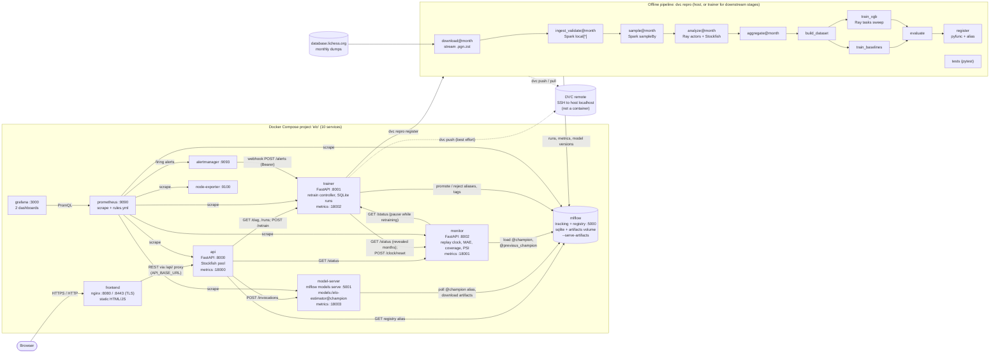
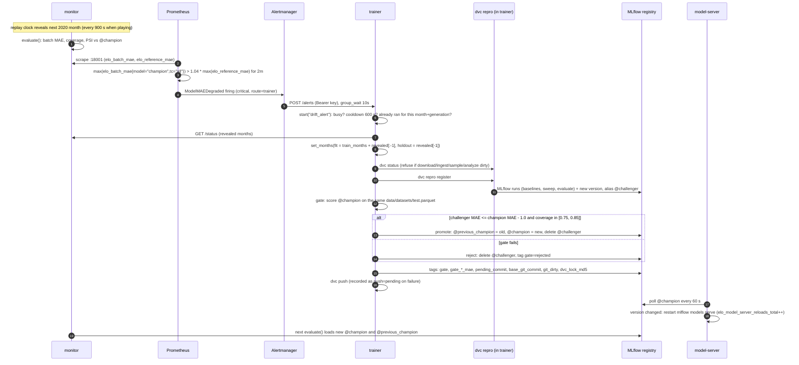
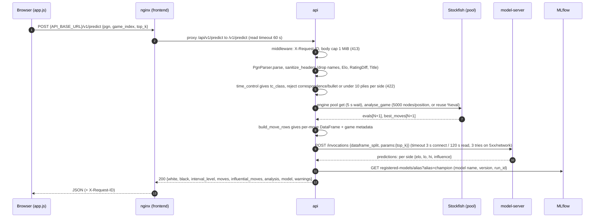

# Guess the Elo: Architecture

This document describes the system as it is built: the ten Docker Compose services in `docker-compose.yml`, the offline DVC pipeline in `dvc.yaml`, and the host-side DVC remote. Where the code and `DESIGN.md` differ, this document follows the code. Decision IDs (U1–U4, D1–D30) refer to the decision log summarised in `DESIGN.md` §4 and §19–§24.

## 1. Architecture diagram

## 2. The blocks

Ports in the form `127.0.0.1:N` are bound to loopback only (`docker-compose.yml`). Others are published on all host interfaces.

| Block | Responsibility | Technology | Ports | Talks to | Decisions |
|---|---|---|---|---|---|
| **frontend** | Single page with an Estimate view (paste/upload PGN, game picker, board replay with influential moves, rating cards) and a Pipeline view. `help.html` is a static manual. Serves `config.js` generated at start-up. Proxies `/api/*` to the api. | `nginxinc/nginx-unprivileged:1.28.0-alpine`, chess.js, chessboard.js, jQuery (vendored) | 8080 (HTTP), 8443 (TLS, only if `certs/localhost.pem` exists) | api, only through `API_BASE_URL` | U1, D20 (TLS via mkcert, CSP headers) |
| **api** | Public REST boundary. Parses and sanitises PGN, runs Stockfish (pool of `ENGINE_POOL=2` engines at 5000 nodes), builds per-move feature rows, calls the model-server, shapes the response. Proxies pipeline reads to trainer and monitor, and retrain (with API key) to trainer. | FastAPI 0.163, uvicorn (1 worker), python-chess, Stockfish binary in image | 8000; metrics 18000 (internal) | model-server, mlflow (alias lookup), trainer, monitor | D9, D16, D20, D28 |
| **model-server** | Serves the registered pyfunc for alias `@champion`. A supervisor (`services/model_server/serve.py`) polls the alias every `ALIAS_POLL_S` (60 s) and restarts `mlflow models serve` when it changes. | MLflow 3.18 scoring server, XGBoost | 5001; metrics 18003 (internal) | mlflow | D9, D10, D11 |
| **mlflow** | Tracking server and model registry. Backend `sqlite:////mlflow/mlflow.db`; artifacts at `/mlflow/artifacts`, served through the server (`--serve-artifacts`), so no client needs storage credentials. Exposes Prometheus metrics at `/metrics`. | MLflow server | 5000 | (passive) | D11, D13, D27 |
| **monitor** | Replay clock over the 12 months of 2020 (state persisted in `/state/monitor.json`). Every `eval_interval_s` (30 s) scores the newest revealed month with `@champion` and `@previous_champion`, computes MAE per time-control class, interval coverage and per-feature PSI, and exports them as gauges. | FastAPI, mlflow-skinny, XGBoost, pandas | 127.0.0.1:8002; 127.0.0.1:18001 | mlflow, trainer; reads `data/features/games/*.parquet` (read-only mount) | D17, D26, D30 |
| **trainer** | Retrain controller. Receives Alertmanager webhooks and manual requests, sets the training months in `params.yaml`, runs `dvc repro register`, applies the promotion gate, moves aliases, tags provenance, attempts `dvc push`, and keeps run history in SQLite. Serves the DVC DAG. | FastAPI, DVC, MLflow, Ray (for the XGBoost sweep), git (read-only `.git`) | 127.0.0.1:8001; 127.0.0.1:18002 | mlflow, monitor, host DVC remote via `host.docker.internal` | D12, D13, D22, D30 |
| **prometheus** | Scrapes 7 jobs every 15 s, evaluates 6 alert rules, keeps 15 days of data. | `prom/prometheus:v3.16.0` | 127.0.0.1:9090 | all exporters, alertmanager | D16 |
| **alertmanager** | Routes `ModelMAEDegraded` to the trainer webhook with a Bearer key read from a Compose secret; all other alerts go to a no-op `log` receiver. Two inhibition rules. | `prom/alertmanager:v0.35.0` | 127.0.0.1:9093 | trainer | D30 |
| **grafana** | Two provisioned dashboards: *Service health* and *Model quality, drift and pipeline*. Anonymous Viewer access. | `grafana/grafana:13.3.1` | 127.0.0.1:3000 | prometheus | D26 |
| **node-exporter** | Host CPU, memory and disk metrics. | `prom/node-exporter:v1.12.1` | 9100 (internal) | (scraped) | D16 |
| **Offline DVC pipeline** (not a service) | 11 stage definitions, 5 of them `foreach` over the 16 months (the live `/dag` output lists 85 stage nodes): download → Spark ingest/validate → Spark sample → Ray/Stockfish analyze → aggregate → build_dataset → baselines, XGBoost sweep → evaluate → register; plus `tests`. Training stages call `mlflow run . -e <entry>`. | DVC, Spark `local[*]`, Ray local cluster, MLflow Projects | Spark UI 4040, Ray dashboard 8265 while running | Lichess, mlflow, DVC remote | D1, D2, D3, D12, D13 |
| **DVC remote** (host, not a container) | Content-addressed store for data and model outputs. URL and key live in the untracked `.dvc/config.local`; the committed `.dvc/config` only names the remote `storage` with a placeholder URL. The trainer uses a generated overlay (`services/trainer/dvc.local`) that points at `host.docker.internal`. | `dvc[ssh]`, host sshd | 22 on the host | trainer, host `make sync` | D27 |

**Volumes.** `mlflow-data` (registry and artifacts), `monitor-state` (replay clock), `trainer-state` (SQLite run history and per-run logs), `prometheus-data`, `grafana-data`. The trainer also bind-mounts the repository at `/repo` (read-write, `.git` read-only) because it runs DVC against the working tree.

**Start-up order.** `mlflow` (healthy) → `model-server` (healthy, `/ping`) → `api` (`/health`) → `frontend`. Every custom service has a Compose healthcheck (D18).

## 3. Retraining sequence

The trigger is the `ModelMAEDegraded` alert only. `FeatureDriftHigh` is a warning that is not routed to the trainer (and is inhibited while `ModelMAEDegraded` fires).

While a retrain runs, the monitor's loop asks `trainer /status` before revealing another month and waits if `in_progress` is true (`src/elo/monitoring/monitor.py:184`). Rollback is the host command `make rollback` (`python -m elo.training.registry rollback`), which sets `@champion` to `@previous_champion`; the model-server picks it up on its next poll.

## 4. Serving request sequence

Influence computation happens inside the model-server (the pyfunc), not in the api, so it is versioned with the model (D8, D10).

## 5. Loose coupling

- **Frontend to backend.** The frontend never hard-codes a backend address. At container start `services/frontend/docker-entrypoint.d/40-elo-config.sh` validates the `API_BASE_URL` environment variable (default `/api`) and writes `config.js` (`window.ELO_CONFIG = {API_BASE_URL, MLFLOW_PORT, GRAFANA_PORT, PROMETHEUS_PORT}`). Every API call in `services/frontend/site/app.js` is `fetch(config.API_BASE_URL + path)`. The nginx `/api/` proxy target is also an environment variable (`API_UPSTREAM`), so the api can move without rebuilding the image.
- **Service to service.** All runtime interaction is REST over the Compose network, with base URLs from environment variables: `MODEL_SERVER_URL`, `MLFLOW_TRACKING_URI`, `TRAINER_URL`, `MONITOR_URL`. No service imports another service's process state.
- **Model contract.** The api depends only on the MLflow `/invocations` contract (per-move rows in, per-side predictions out). Aggregation, conformal intervals and occlusion travel inside the pyfunc, so a new model version needs no api change (D9, D10).
- **Registry aliases as the switch.** Training publishes versions; serving and monitoring resolve `@champion` at run time. Promotion and rollback change one alias (D11).
- **Alerts as webhooks.** Prometheus and Alertmanager know only the trainer's `/alerts` URL; the trainer knows nothing about PromQL.
