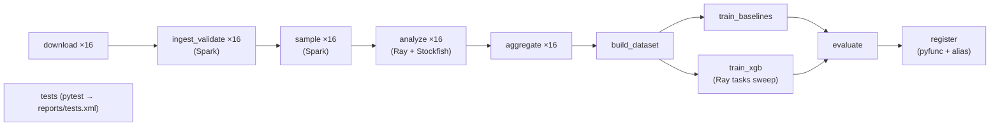

# Guess the Elo: project report

**Kirthan S (DA24B009)** · DA3408 AIOps Lab, course project · submitted 2026-11-18

Repository: <https://github.com/kirthans/da3408-final-project> (branch `main`)

You give the app one chess game as a PGN. It estimates both players' **Lichess-equivalent ratings** with an **80% interval**, and shows the **moves that most influenced the estimate**. The rating headers in the file are never used.

A pipeline built with Spark, Ray and Stockfish runs under DVC and trains an XGBoost model, which is tracked in MLflow. MLflow serves the model behind FastAPI, and a static web UI calls it. Prometheus and Grafana watch the model on a month-by-month **replay of 2020 Lichess games**. When the error drifts, an alert retrains the model by itself and promotes it only if it beats the current model on unseen data.

This report covers the whole project. Chapters A–F at the end are the mandatory documents: architecture, HLD, LLD, test plan, test report and user manual. Chapter G is the AI-use disclosure.

---

## 1. Results at a glance

| AC | Acceptance criterion | Measured | Result |
|---|---|---|---|
| AC1 | Test MAE ≤ 0.75 × MAE of baseline B1 (mean per time control) | **0.651** × B1 (191.1 vs 293.6 Elo) | PASS |
| AC2 | 80% interval coverage within [0.75, 0.85] | **0.793** | PASS |
| AC3 | `/v1/predict` p95 latency ≤ 5 s with 1 client | **0.63 s** (0.72 s with 2 clients, 1.26 s with 4; 0 errors in 499 requests) | PASS |
| AC4 | Invalid input returns 4xx, never 5xx | **32/32** contract tests | PASS |
| AC5 | A drift alert triggers a retrain, and the promoted model is better on the following month | Alert in 2020-04 → automatic retrain → v10 promoted; **v10 beat v4 in every month from May to December** (by 3.1–4.1 Elo) | PASS |
| AC6 | All unit tests pass | see the test report (Chapter E) | PASS |

Every number above comes from a file the pipeline wrote: `reports/metrics.json`, `reports/baselines.json`, `reports/load_test.json`, `reports/tests.xml` and `reports/ac5.json`. `make test-report` regenerates `docs/test_report.md` from those files.

## 2. Where each rubric item is

| Rubric item | Where to look |
|---|---|
| **UI/UX** (intuitive, foolproof, responsive, user manual) | The UI at `http://localhost:8080`; §9 of this report; **Chapter F, user manual** (`docs/user_manual.md`); `services/frontend/site/` |
| **ML pipeline visualisation** (pipeline screen, management console, errors and runs, speed and throughput) | The **Pipeline tab** (§9.2): DVC DAG, run history with errors, gate results and per-stage throughput, retrain button. Links into MLflow and Grafana. Throughput is in §4. |
| **Design document**, OO or functional paradigm | `DESIGN.md` (decision log D1–D30 with alternatives and course links); **Chapter B, HLD** §11 (paradigm) |
| **LLD with API endpoints and I/O** | **Chapter C** (`docs/lld.md`): every endpoint with request and response schemas and error codes |
| **Architecture diagram**, **HLD diagram** | **Chapter A** (`docs/architecture.md`) §1 diagram and §2 block explanations; retraining and serving sequence diagrams in A §3–4; HLD in **Chapter B** |
| **Loose coupling** of frontend and backend | Only configurable REST through `API_BASE_URL`, written into `config.js` at container start (`services/frontend/docker-entrypoint.d/40-elo-config.sh`) (Chapter A §5) |
| **Coding style, logging, exceptions, inline docs** | `ruff` + `black` in `make lint`; JSON logs with `request_id` (`src/elo/common/logging.py`); exception classes mapped to HTTP codes (`src/elo/common/errors.py`); docstrings on every module, class and function |
| **Unit tests**, test plan, test cases, test report, acceptance criteria | `tests/`; **Chapter D** (plan and case list); **Chapter E** (generated report with counts); §1 above |
| **Data engineering** with Spark or Ray, throughput | §4: Spark ingest and sampling, Ray actor pool with Stockfish; `reports/validation/`, `reports/throughput/` |
| **CI with DVC**, DVC DAG, Git, LFS and DVC | §5; `dvc.yaml`, `dvc.lock`, `dvc dag`; `.gitattributes` (LFS) |
| **Experiment tracking** (autolog and beyond; metrics, parameters, artifacts) | §6, with MLflow screenshots |
| **Prometheus instrumentation, Grafana in near-real time** | §8; `infra/prometheus/`, `infra/grafana/`; metric catalogue in Chapter C §6 |
| **Packaging**: MLflow serving, MLproject, FastAPI, Docker, Compose | §7; `MLproject`, `python_env.yaml`, `docker-compose.yml`, `services/*/Dockerfile` |
| **AI-use disclosure** | **Chapter G** (`AI_DISCLOSURE.md`) |

## 3. Problem and data

**Task.** This is regression: one rating per player per game, on the Lichess scale for that game's time control. The interval is calibrated to 80% coverage, and the explanation is given per move, not per feature.

**Data.** The Lichess Open Database (CC0), monthly dumps. The months are fixed in `params.yaml`:
- **Training:** 2019-09 to 2019-12.
- **Production stream:** 2020-01 to 2020-12. 2020 was chosen because lockdowns and the *Queen's Gambit* series brought a wave of new players, so it contains real drift.

The downloader streams each `.zst` file and stops after 60,000 games per month.

**Filters** (Spark):
- rated, standard chess, with clock annotations;
- blitz, rapid or classical (bullet is excluded);
- at least 20 plies;
- both ratings present and between 600 and 3200.

**Leakage controls:**
- `WhiteElo`, `BlackElo`, `*RatingDiff` and `Title*` are stripped before features are built.
- Player names are hashed and never used.
- Splits are by time.

**What the data shows** (from `reports/validation/*.json`; 960,000 raw games, 577,618 after the filters):


- **The mean rating rose.** It went from 1,584 (2019-09) to 1,699 (2020-04), the lockdown peak, and fell back to 1,615 in December. A model trained on 2019 is therefore tested on a shifted population.
- **The time-control mix shifted.** Classical games fell from about 4–5% of filtered games to about 1% from May 2020. This is exactly the `tc_class` feature that the drift monitor flagged (PSI ≈ 0.057, §8).
- **What the filters removed** in a typical month (2019-09): 22,507 of 60,000 games were bullet or another excluded time control, 1,565 were too short, and 187 had no clocks.

**Sample sizes.** 20,000 games per training month and 10,000 per replay month, stratified by time control. The resulting dataset has 110,000 training games (220,000 rows, one row per player perspective) and 3,300–3,400 games each for validation, calibration and test.

## 4. Data engineering (Spark and Ray)

| Stage | Tool | What it does | Measured throughput |
|---|---|---|---|
| `download@month` | Python, streaming `zstandard` | Streams the dump and stops after 60k games | network-bound |
| `ingest_validate@month` | **Spark** `local[*]` | Splits records on a custom delimiter, parses headers, applies the filters, deduplicates and writes Parquet. Counts are recorded per filter. | **6,000–6,700 games/s** (16 months, 960k games, 149 s in total) |
| `sample@month` | **Spark** `sampleBy` | Stratified sample by time control | seconds per month |
| `analyze@month` | **Ray** actor pool (10 actors, each owning one Stockfish process, 5,000 nodes per move) | Builds per-move features: centipawn loss, win-probability loss, best-move match, move class, clock use, material, phase | **10.3–11.2 games/s** (about 760 plies/s); 200,000 games and 14.0 M plies in 5.1 h; **0 failed games** |
| `aggregate`, `build_dataset` | pandas | Per-game aggregates, perspective rows, splits, clock dropout, reference statistics for drift | – |

Why Spark for ingest and Ray for analysis (D1, D2): ingest is columnar and data-parallel. The engine stage is stateful and CPU-bound: each actor keeps one Stockfish process alive, while a Spark Python UDF would restart engines and pay JVM↔Python overhead. Per-stage throughput is written to `reports/throughput/*.json`, exported to Prometheus by the trainer (`elo_stage_throughput_games_per_second`) and shown in the Pipeline tab.

## 5. Source control and continuous integration

- **Git** holds the code, configuration, `dvc.yaml`, `params.yaml`, `dvc.lock` and the reports.
- **Git LFS** holds the binary assets that must be present on clone: test PGN fixtures and the documentation screenshots (`.gitattributes`).
- **DVC** holds the data and models: about 85 stage instances, because the per-month stages use `foreach`. The remote is SSH (D27; no cloud allowed). `make sync` runs `dvc push`.
- **The DVC DAG is the CI pipeline** (D12):



- `dvc repro` rebuilds only what changed; `dvc.lock` pins every input, parameter and output hash.
- Training stages run as `mlflow run . -e <entry>` (D13), so every MLflow run records its git commit.
- `make ci` runs `ruff` and `black --check`, the unit tests, `dvc status` and the AC1/AC2 threshold check.
- **Automatic retraining** is the same DAG: the trainer runs `dvc repro register` with new `params.yaml` months (§8).

## 6. Experiment tracking (MLflow)

| What | How |
|---|---|
| **Autolog** | `mlflow.xgboost.autolog()` in each sweep trial: per-iteration `validation_0-mae`, booster parameters, feature importance |
| **Parameters beyond autolog** | All of `params.yaml` (months, sample sizes, Spark settings, engine nodes, sweep grid, conformal α, gate thresholds), 38 parameters per run |
| **Metrics beyond autolog** | `val_mae_iteration` per boosting step, `best_iteration`; test MAE and RMSE; MAE by time control and by rating band; coverage per time control; interval width; no-clock MAE; improvement over B0, B1 and B2; analysis throughput |
| **Artifacts** | Residual and coverage plots, feature list, `reference_stats.json`, conformal radii, gain importance, the packaged pyfunc model |
| **Tags (provenance)** | `trigger` (manual or `drift_alert`), `alert_name`, `train_months`, `parent_champion_version`, `dvc_data_md5`, `mlflow.source.git.commit`. Model versions also carry the gate result (`gate`, `gate_champion_mae`, `gate_challenger_mae`), `pending_commit`, `base_git_commit`, `git_dirty` and `dvc_lock_md5`. |
| **Sweeps** | A 3 × 2 grid (`max_depth` 4/6/8 × `learning_rate` 0.05/0.1), run in parallel as **Ray tasks** with **nested runs**. The best trial is chosen with `mlflow.search_runs` on validation MAE. |
| **Registry** | Model `elo-estimator` with aliases `@champion`, `@challenger` and `@previous_champion` (D11) |


## 7. Model, serving and packaging

**Model** (D4, D6–D8):
- XGBoost on per-game aggregates for each side: CPL statistics, accuracy, blunder, mistake and inaccuracy rates, time use, material swings, opening depth, plus the game context.
- Each game gives two "perspective" rows (own features, opponent's features, colour), so one model rates both players.
- 20% of training games have their clocks removed, so the model still works on over-the-board PGNs without clocks.
- Baselines: B0 global mean (297.4 Elo test MAE), B1 mean per time control (293.6), B2 linear (288.9). The champion scores **191.1**.

**Uncertainty.** Split conformal, Mondrian by time control. The 80% intervals are on average 594 Elo wide.

**Influential moves.** Occlusion: each move is masked, the game re-aggregated, and the change in prediction recorded. Opening-phase moves are not ranked, because they are mostly memorised theory.

**Packaging** (D9, D10, D13, D18):
- **MLflow for APIfication.** A custom **pyfunc** (aggregation, conformal and occlusion travel with the model version) is served with `mlflow models serve models:/elo-estimator@champion` in the `model-server` container. It polls the alias and reloads when it moves.
- **FastAPI** (`api`) holds the UI-facing endpoints: parse, predict, model info, pipeline DAG, runs, replay and retrain. It runs Stockfish with the same `elo.features` code as the pipeline, which avoids training/serving skew.
- **MLproject** and `python_env.yaml` give the same environment for development and test runs.
- **Docker Compose** runs 10 services: `frontend`, `api`, `model-server`, `mlflow`, `trainer`, `monitor`, `prometheus`, `alertmanager`, `grafana`, `node-exporter`. Images are multi-stage and non-root. Healthchecks gate start-up. Admin ports are bound to 127.0.0.1.

## 8. Monitoring, drift and automatic retraining

- **Exporters on every component:**
  - api: requests, latency histogram, in-flight requests, engine time, parse errors by reason, predicted-rating and interval-width distributions;
  - model-server: serving version, reloads;
  - monitor: MAE per model and time control, coverage, PSI per feature (45 features), replay month;
  - trainer: runs by status, stage durations and throughput, champion version;
  - MLflow `/metrics` and node-exporter.
- **Alerts** (`infra/prometheus/rules.yml`, each AI-written PromQL with its prompt as a comment): `ModelMAEDegraded` (critical, routed to the trainer), `FeatureDriftHigh`, `CoverageOutOfBand`, `ApiErrorRateHigh`, `ApiLatencyP95High`, `ServiceDown`.
- **Grafana:** two provisioned dashboards, "Service health" and "Model quality, drift and pipeline", refreshed every 15 s, with champion-change annotations.

**The loop** (Chapter B §8):
1. The monitor reveals one 2020 month at a time.
2. MAE above 1.04 × the champion's reference for 2 minutes fires `ModelMAEDegraded`.
3. Alertmanager posts the alert to the trainer.
4. The trainer runs `dvc repro register` on the revealed months, with the newest month held out.
5. The trainer gates the challenger: it must be at least 1 Elo better than the champion on the same rows, with coverage in [0.75, 0.85].
6. If it passes, the trainer moves the aliases. The model-server reloads by itself.

**What happened in the full, unattended replay** (no drift injection):

| Month | Champion | Champion MAE | Previous champion (v4) MAE | Gain |
|---|---|---|---|---|
| 2020-01 – 03 | v4 | 186.5 / 184.8 / 187.9 | – | |
| **2020-04** | v4 → **v10** | 193.6 (1.06 × reference) → alert → retrain (about 28 s) → gate 191.1 vs 196.0 → **promoted** | | |
| 2020-05 | v10 | 183.25 | 186.84 | −3.58 |
| 2020-06 | v10 | 177.95 | 181.79 | −3.84 |
| 2020-07 | v10 | 178.63 | 181.77 | −3.14 |
| 2020-08 | v10 | 181.73 | 185.55 | −3.81 |
| 2020-09 | v10 | 179.44 | 182.98 | −3.54 |
| 2020-10 | v10 | 180.63 | 183.85 | −3.23 |
| 2020-11 | v10 | 184.41 | 187.98 | −3.57 |
| 2020-12 | v10 | 181.62 | 185.69 | −4.08 |


## 9. The web application

### 9.1 Estimate

**The flow:** paste or drop a PGN, then pick a game if the file holds several. Choose a time control if the PGN has none, then press **Estimate**. The result shows:
- a rating card for each player, with the 80% range drawn as a bar;
- the file's own ratings as a dashed marker, for comparison only;
- a board you can step through, with weak moves marked;
- the list of moves that shaped the estimate.

Every error has a plain-language message and a request ID. The layout is responsive down to phone width, uses a colour-blind-safe palette, and serves HTTPS on 8443.


### 9.2 Pipeline console

**What the tab shows:**
- the current and previous model, with their MAE;
- the replay month, the MAE ratio, coverage and drift status;
- the **DVC DAG**, grouped into stage families;
- the **run history**, with trigger, status, the gate decision in words, per-stage durations, throughput and errors;
- a retrain form protected by the API key;
- links to MLflow, both Grafana dashboards and Prometheus alerts.

It refreshes every 10 s.


## 10. Testing

| Level | What | Where |
|---|---|---|
| Unit | Parser and leakage stripping, features, engine wrapper (mocked), aggregation, conformal, PSI, gate and aliases, monitor, reporting | `tests/unit/` |
| Contract (AC4) | 32 malformed or hostile inputs; each must give a 4xx with the standard error shape | `tests/contract/` |
| Integration | Smoke test against the running stack (`ELO_SMOKE=1`) | `tests/integration/` |
| Load (AC3) | Closed loop with 1, 2 and 4 clients for 60 s each | `tests/load/`, `make loadtest` |
| Pipeline | Data validation counts, the AC1/AC2 threshold check, and `tests` as a DVC stage | `dvc.yaml` |
| End to end (AC5) | Full 2020 replay; evidence rebuilt from Prometheus and the trainer's run records | `scripts/ac5_evidence.py`, `make ac5` |

The full plan and case list are in Chapter D, and the generated report with pass and fail counts is in Chapter E.

## 11. Limitations and future work

- **One game is a small sample.** The 80% interval is about ±300 Elo, which is honest but wide.
- **The retrain gain is modest:** about 2% of MAE. In May, classical (the smallest group, about 1% of games) got worse while blitz and rapid improved.
- **The alert threshold is relative to each champion's own holdout MAE.** After promotion it rose from about 190 to about 199, because v10 was evaluated on the harder April data. For that reason no second retrain fired. A fixed reference would be a reasonable alternative.
- **Upstream stages are not retrained inside the container.** Retraining assumes the replay months were already analysed on the host; the trainer image has no Java or Stockfish (DESIGN §24 A2).
- **Single host.** Mapping to Kubernetes: api and model-server become Deployments with HPA, a retrain becomes a Job, and rollback becomes `kubectl rollout undo` (Chapter B §12).
- **Data access.** The DVC remote is on the author's machine, so a fresh clone gets code, configuration, `dvc.lock` and reports, but not the data. `dvc repro` rebuilds the data from the public Lichess dumps, which takes about 5 h of Stockfish for the full sample.

## 12. How to run it

```bash
conda env create -f environment.yml && conda activate da3408-project
cp .env.example .env            # set API_KEY and GRAFANA_ADMIN_PASSWORD
make up                         # builds and starts the 10 services
open http://localhost:8080      # the app;  :3000 Grafana;  :5000 MLflow;  :9090 Prometheus
make test lint                  # unit and contract tests, style
dvc repro                       # the full pipeline (data from the Lichess dumps)
make replay-reset && make replay-play   # run the 2020 replay demo
```

---

The chapters that follow are the mandatory documents, included unchanged from `docs/`:

- **A.** Architecture: diagram and explanation of the blocks (`docs/architecture.md`)
- **B.** High-level design (`docs/hld.md`)
- **C.** Low-level design: endpoints and I/O (`docs/lld.md`)
- **D.** Test plan and test cases (`docs/test_plan.md`)
- **E.** Test report (`docs/test_report.md`)
- **F.** User manual (`docs/user_manual.md`)
- **G.** AI-use disclosure (`AI_DISCLOSURE.md`)
